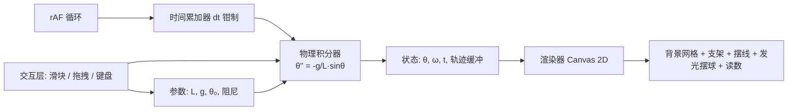

## 产品概述

在当前工作区根目录创建一个独立可运行的 `index.html`，实现带物理简谐振动的单摆模拟器。双击文件即可在浏览器中看到摆球在深灰科技色背景中持续、流畅地左右摆动。

## 核心功能

- 单摆物理仿真：以摆长 L=200px、重力 g=9.8、初始摆角 45° 为默认参数，基于单摆运动方程进行数值积分，呈现真实的往复摆动。
- 原生 Canvas 绘制：无外部依赖，自行绘制支架、摆线、枢轴与摆球。
- 科技感视觉：深灰科技色背景（#1a1a24），摆球带微弱发光光晕，整体呈暗色高对比的实验室质感。
- 动画循环：使用 requestAnimationFrame 驱动物理步进与画面重绘，保证平滑连续。
- 数据读数：实时显示摆角、角速度/周期等状态量，便于观察振动规律。
- 轻量交互：可调摆长、重力、初始角度与阻尼，支持拖拽摆球设定角度、暂停/继续与重置。

## 技术栈选型

- 纯原生 HTML5 + CSS3 + ES6 JavaScript（单文件内联，零外部库、零构建、零网络请求，file:// 协议可直接打开）
- 渲染：Canvas 2D API（radialGradient / shadowBlur 实现发光）
- 驱动：requestAnimationFrame + 固定步长累加器（fixed timestep accumulator）

## 实现方案

**整体策略**：单文件内划分"物理层 / 渲染层 / 交互层"三段式逻辑，物理与渲染解耦，积分精度与帧率无关。

**关键决策**：

1. **物理模型**：采用单摆非线性方程 `θ'' = -(g/L)·sinθ`。由于 g=9.8 是 SI 单位而 L=200 是像素，需引入比例尺 `PPM = 100 px/m`（即 L_eff = L/100 = 2 m），使周期 T ≈ 2π√(L/g) ≈ 2.8 s 量级，观感自然。同时保留"小角度简谐解"作为对照参考值（θ(t)=θ₀·cos(ωt)），体现简谐振动特性但不作为主仿真。
2. **积分器**：固定步长 `dt = 1/240 s` 的半隐式（辛）欧拉或 RK4；用累加器消化真实帧间隔并对单帧步数设上限（如 8 步），避免切后台回来后"补帧爆炸"。
3. **阻尼**：默认极小阻尼（接近 0），保证长时间持续摆动不衰减；阻尼可作为可调项，避免用户看到"停摆"。
4. **渲染质量**：按 devicePixelRatio 缩放画布 backing store 并 `ctx.setTransform(dpr,0,0,dpr,0,0)`，防止高分屏模糊；窗口 resize 时重算尺寸与枢轴位置。
5. **发光实现**：摆球用 `createRadialGradient` 绘制本体 + `shadowBlur`/`shadowColor` 冷色光晕；光晕随角速度轻微增强，产生"能量感"，但幅度克制（微弱发光）。
6. **性能**：每帧绘制元素极少（背景、网格、支架、摆线、摆球、文字），O(1) 复杂度；轨迹缓冲用定长环形数组（约 600 点）避免数组无限增长与 GC 抖动。

**复杂度与瓶颈**：单帧计算 O(1)；主要开销在 shadowBlur（较贵），通过仅对摆球启用 shadow、其余元素关闭 shadowBlur 来控制；文字读数每帧刷新但可用节流（约 10 fps 更新文本层）降低布局压力。

## 执行要点

- 坐标约定：角度 θ 以竖直向下为 0，向右为正；摆球坐标 `x = pivot.x + L·sinθ`，`y = pivot.y + L·cosθ`。
- 枢轴位置随窗口尺寸与摆长自适应，保证 L=200px 时摆球不超出画布（画布高度需 ≥ 摆长 + 余量）。
- 拖拽交互时暂停积分并冻结角速度为 0，释放后以拖拽角度为新初始角继续仿真。
- 页面失焦/切标签时依赖 rAF 自动暂停，恢复时用 `Math.min(deltaTime, 0.1)` 钳制，防止大跳变。
- 全部样式与脚本内联在 `<style>` / `<script>` 中，不引入任何 CDN 或字体外链，确保离线双击可用。

## 架构设计



## 目录结构

```
c:/Users/A/CodeBuddy/20261019104142/
└── index.html   # [NEW] 单文件单摆模拟器。内联 CSS（页面与画布布局、暗色主题）与 JS（参数状态、物理积分器、Canvas 渲染器、交互控制、rAF 主循环）。不引用任何外部资源。
```

## 设计风格

暗色实验室科技风（Dark Tech / Glassmorphism 轻元素）：深灰背景配冷色霓虹点缀，强调"仪器感"与"数据感"。Canvas 铺满主视区，右下或顶部浮一层半透明磨砂控制面板。

## 页面结构（单页）

1. 顶部标题条：项目名"单摆简谐振动模拟器" + 右侧状态徽标（运行中 / 已暂停）。
2. 主画布区：占满视口，绘制微弱网格背景、顶部枢轴支架、摆线、发光摆球、摆动弧线参考虚线与角度扇形指示。
3. 左下读数面板：实时角度、角速度、周期、能量，等宽字体排版，数值带冷色高亮。
4. 右侧参数面板：摆长 L、重力 g、初始角度、阻尼四个滑块 + 暂停/重置按钮，玻璃拟态卡片。

## 视觉要点

- 背景 #1a1a24 叠加极淡径向渐变与 40px 网格线（透明度极低），避免纯色呆板。
- 摆球：冷青/蓝白渐变球体，外圈 soft glow（shadowBlur 约 15-25），随速度轻微呼吸。
- 摆线：细长低饱和灰蓝线，端点枢轴带金属高光圆点。
- 交互：滑块自定义样式（细轨 + 发光 thumb），按钮 hover 有微亮与位移；面板出现带 200ms 淡入。
- 响应式：窗口 resize 时画布与枢轴自适应；小屏时参数面板收窄为底部条。

## Agent Extensions

### SubAgent

- **code-explorer**
- Purpose：确认工作区为空、无既有工程约定或可复用资产，避免臆造既有文件与规范。
- Expected outcome：确认 `c:/Users/A/CodeBuddy/20261019104142` 下无源码/配置，本次为纯新建单文件任务，方案可安全落地。